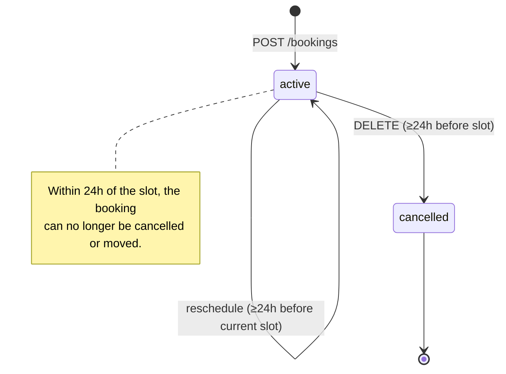

# Biometrics Appointment API

A FastAPI service for booking, cancelling and rescheduling biometrics appointment slots across multiple centers. It is built around correctness under concurrency and strict time handling: every timestamp the API accepts or returns is **UTC**.


---

## Table of contents

- [Features](#features)
- [Quick start](#quick-start)
- [Project structure](#project-structure)
- [Business rules](#business-rules)
- [API reference](#api-reference)
- [Error model](#error-model)
- [Booking lifecycle](#booking-lifecycle)
- [Design decisions](#design-decisions)
- [Testing](#testing)
- [Seed data](#seed-data)
- [Known limitations](#known-limitations)
- [Roadmap](#roadmap)

---

## Features

- Browse available slots, filtered by center and UTC time range
- Book a slot with one-active-booking-per-applicant enforcement
- Cancel with a 24-hour cutoff
- Atomic reschedule: a failed reschedule never loses the applicant's current seat
- Case-insensitive, whitespace-tolerant applicant IDs (`" ab1 "` and `AB1` are the same person)
- Strict UTC-only time filters (naive and offset datetimes are rejected)
- Structured, machine-readable error codes
- Thread-safe: no overbooking and no double booking under concurrent requests
- Deterministic automated test suite with a frozen clock

---

## Quick start

```bash
git clone https://github.com/manish-2412/visa-biometrics-booking-api.git
cd biometrics-api

python -m venv venv
source venv/bin/activate          # Windows: venv\Scripts\activate

pip install -r requirements.txt
uvicorn app.main:app --reload
```

The API is now at `http://127.0.0.1:8000`.
Interactive docs (Swagger UI): `http://127.0.0.1:8000/docs`
ReDoc: `http://127.0.0.1:8000/redoc`

### Try it

```bash
# 1. See what's available in Delhi
curl "http://127.0.0.1:8000/slots?center=delhi"

# 2. Book slot S1
curl -X POST http://127.0.0.1:8000/bookings \
  -H "Content-Type: application/json" \
  -d '{"applicant_id": "AB123", "slot_id": "S1"}'

# 3. List your bookings
curl "http://127.0.0.1:8000/bookings?applicant_id=ab123"

# 4. Reschedule to another slot (use the booking_id from step 2)
curl -X POST http://127.0.0.1:8000/bookings/<booking_id>/reschedule \
  -H "Content-Type: application/json" \
  -d '{"new_slot_id": "S3"}'

# 5. Cancel
curl -X DELETE http://127.0.0.1:8000/bookings/<booking_id>
```

---

## Project structure

```
biometrics-api/
├── app/
│   ├── __init__.py
│   ├── main.py          # FastAPI routes, request models, error handler
│   ├── service.py       # Business logic, in-memory store, locking
│   └── seed.py          # Slot seed data (mixed IST/UTC inputs)
├── tests/
│   ├── __init__.py
│   ├── conftest.py      # Frozen clock, state reset, shared fixtures
│   └── test_api.py      # 70 tests: endpoints, edge cases, concurrency
├── pytest.ini
├── requirements.txt
├── requirements-dev.txt
└── README.md
```

The code is split into two layers on purpose. `main.py` handles HTTP concerns only (parsing, status codes, serialisation). `service.py` holds every rule and knows nothing about HTTP, so it can be tested directly, including under threads.

---

## Business rules

| Rule | Detail |
|---|---|
| **Timezone** | All inputs and outputs are UTC. Seed slots defined in IST are converted once at load. |
| **Applicant identity** | IDs are trimmed and uppercased before any comparison. `ab1`, ` AB1 ` and `Ab1` are the same person. |
| **One booking** | An applicant may hold only one *active, upcoming* booking. A booking whose slot has already passed no longer blocks new bookings. |
| **Capacity** | A slot cannot be booked once active bookings reach its capacity. Capacity `0` means never available. |
| **Past slots** | A slot is past when `start <= now`. It cannot be booked or rescheduled into, and is hidden from `GET /slots`. |
| **Cancellation cutoff** | Cancel only if `start - now >= 24h`. Exactly 24h is allowed; one second less is rejected. |
| **Reschedule cutoff** | The same 24h rule applies to the *current* slot. The new slot only needs to be in the future and have a free seat. |
| **Cancelled bookings** | Soft-deleted (`status: "cancelled"`). The seat is freed immediately and the applicant can book again. |

---

## API reference

### `GET /slots`

List bookable slots, soonest first. Excludes past, full and zero-capacity slots.

| Query param | Type | Notes |
|---|---|---|
| `center` | string | Case- and whitespace-insensitive match |
| `from_time` | datetime | Inclusive. **Must be UTC** (trailing `Z`) |
| `to_time` | datetime | Inclusive. **Must be UTC** (trailing `Z`) |

```json
[
  {
    "id": "S1",
    "center": "Delhi",
    "start_utc": "2026-11-20T04:30:00Z",
    "capacity": 2,
    "available_seats": 2
  }
]
```

### `GET /slots/{slot_id}`

One slot with live availability. Unlike the list endpoint, this also returns full and past slots, and adds `is_past`.

### `POST /bookings` → `201`

```json
{ "applicant_id": "AB123", "slot_id": "S1" }
```

```json
{
  "booking_id": "6f1c1c1e-...",
  "applicant_id": "AB123",
  "slot_id": "S1",
  "start_utc": "2026-11-20T04:30:00Z",
  "status": "active",
  "booked_at_utc": "2026-11-13T06:00:00Z"
}
```

`applicant_id` is 1–64 characters.

### `GET /bookings?applicant_id=...&include_cancelled=false`

An applicant's bookings, oldest first. Active only unless `include_cancelled=true`.

### `GET /bookings/{booking_id}`

A single booking, in any status.

### `DELETE /bookings/{booking_id}`

Cancels the booking (soft delete) and returns it with `status: "cancelled"` and `cancelled_at_utc`.

### `POST /bookings/{booking_id}/reschedule`

```json
{ "new_slot_id": "S3" }
```

Moves the booking to another slot in one atomic step. The `booking_id` is preserved, `start_utc` and `slot_id` are updated, and `rescheduled_at_utc` is set.

---

## Error model

Every domain error uses the same shape, so clients can branch on `code` rather than parsing messages:

```json
{
  "detail": {
    "code": "SLOT_FULL",
    "message": "No seats left in this slot"
  }
}
```

| HTTP | Code | When |
|---|---|---|
| 404 | `SLOT_NOT_FOUND` | Unknown slot ID (including as a reschedule target) |
| 404 | `BOOKING_NOT_FOUND` | Unknown booking ID |
| 409 | `SLOT_IN_PAST` | Slot has already started or passed |
| 409 | `SLOT_FULL` | No seats left (always the case for capacity 0) |
| 409 | `ALREADY_HAS_BOOKING` | Applicant already has an active upcoming booking |
| 409 | `ALREADY_CANCELLED` | Cancel or reschedule on a cancelled booking |
| 409 | `CANCELLATION_WINDOW_CLOSED` | Less than 24h before the current slot |
| 409 | `SAME_SLOT` | Reschedule target equals the current slot |
| 422 | `TIME_MUST_BE_UTC` | Time filter is naive or has a non-zero offset |
| 422 | `INVALID_APPLICANT_ID` | Applicant ID is blank after trimming |
| 422 | *(FastAPI default)* | Malformed body or query (missing fields, bad types, ID too long) |

The order of checks is deterministic. For example, booking checks existence, then past, then duplicate, then capacity, so a client always gets the most fundamental failure first.

---

## Booking lifecycle



---

## Design decisions

**One global lock around every check-then-write.** Booking is a read-modify-write: count seats, then insert. Without a lock, two requests can both see one free seat and both succeed. All mutating operations in `service.py` run inside a single `threading.Lock`. Read endpoints take it too, so they never see a half-applied change.

**Plain `def` endpoints, not `async def`.** FastAPI runs them in a threadpool, so requests genuinely run in parallel threads. That is exactly why the lock matters and why the concurrency tests are meaningful.

**Reschedule validates everything before mutating anything.** All checks run first, then the booking is updated in one step. A failed reschedule (full or past target) leaves the original seat untouched. There is no "cancel, then try to rebook, then fail" window.

**UTC at the boundary, converted once.** Seed slots may be written in IST or UTC. They are normalised to UTC at load, and time filters are rejected unless they are explicitly UTC. This avoids the classic off-by-one-day bug. For instance, `S10` is Nov 22 00:30 in IST but Nov 21 19:00 in UTC.

**Soft-delete on cancel.** Cancelled bookings stay in the store with a timestamp, which keeps history auditable and makes `include_cancelled` possible.

**Seats are derived, not stored.** `available_seats` is computed from active bookings every time rather than kept as a counter. There is no counter to drift out of sync after a cancel or reschedule.

**Injectable time.** Logic calls `now()` through the module, so tests can freeze the clock and exercise exact boundaries such as the 24h cutoff.

---

## Testing

```bash
pip install -r requirements-dev.txt
python -m pytest -v
```

The suite has **70 tests** and runs in under a second.

| Area | What's covered |
|---|---|
| Slot listing | Hidden past, full and zero-capacity slots; sort order; center filter; inclusive time range; IST→UTC conversion; non-UTC rejection |
| Booking | Success, ID normalisation, duplicates across casing, past, full, empty and too-long IDs, missing fields, no seat consumed on failure |
| Cancel | Seat freed, rebook after cancel, double cancel, **exact 24h boundary and 1 second inside it** |
| Reschedule | Seat moves, ID preserved, full or past or unknown target, cancelled booking, 24h rule, repeated reschedules |
| Reads | By ID, active vs all, ordering, case-insensitive lookup, no cross-applicant leakage |
| Concurrency | 20 threads on a capacity-1 slot; one applicant booking 10 slots at once; reschedule racing a new booking for the last seat |
| Regression | A past booking no longer blocks a new one |

**Determinism.** `conftest.py` freezes the clock at `2026-11-13 11:30 IST` and clears all bookings before every test. Tests never depend on the real date, so they won't rot as the seed dates go stale, and they never leak state into each other.

---

## Seed data

Slots live in `app/seed.py`, deliberately including edge cases:

| Slot | Purpose |
|---|---|
| `S4`, `S6` | In the past |
| `S5` | Bookable but under 24h away (not cancellable) |
| `S8` | Borderline 24h cutoff |
| `S10` | IST date differs from UTC date |
| `S11` | Already specified in UTC |
| `S12` | Same start time as `S1`, different center |
| `S13` | Far future, large capacity |
| `S14` | Capacity 0, never available |

---

## Known limitations

- **In-memory storage.** All bookings are lost on restart. The `slots` and `bookings` dicts are the persistence layer.
- **Single process only.** The lock is a `threading.Lock`, which protects threads inside one process. Running with multiple workers (`--workers N`) would give each worker its own state and its own lock. Moving to a database with row-level locking or unique constraints is required before scaling out.
- **No authentication.** Any caller can read or cancel any booking if they know the ID. Booking IDs are random UUIDs, but they are not a substitute for auth.
- **No pagination** on `/slots` or `/bookings`.
- **Static slots.** There is no endpoint to create or modify slots.

---

## Roadmap

- [ ] `GET /health` and `GET /centers`
- [ ] Pagination (`limit` / `offset`) on list endpoints
- [ ] `GET /slots/{id}/bookings` for staff
- [ ] Idempotency-Key header on `POST /bookings`
- [ ] Admin slot management (create, change capacity without dropping below seats taken)
- [ ] Waitlist with auto-promotion on cancellation
- [ ] Persistent storage (PostgreSQL) with a unique constraint backing the one-booking rule
- [ ] GitHub Actions CI running the test suite